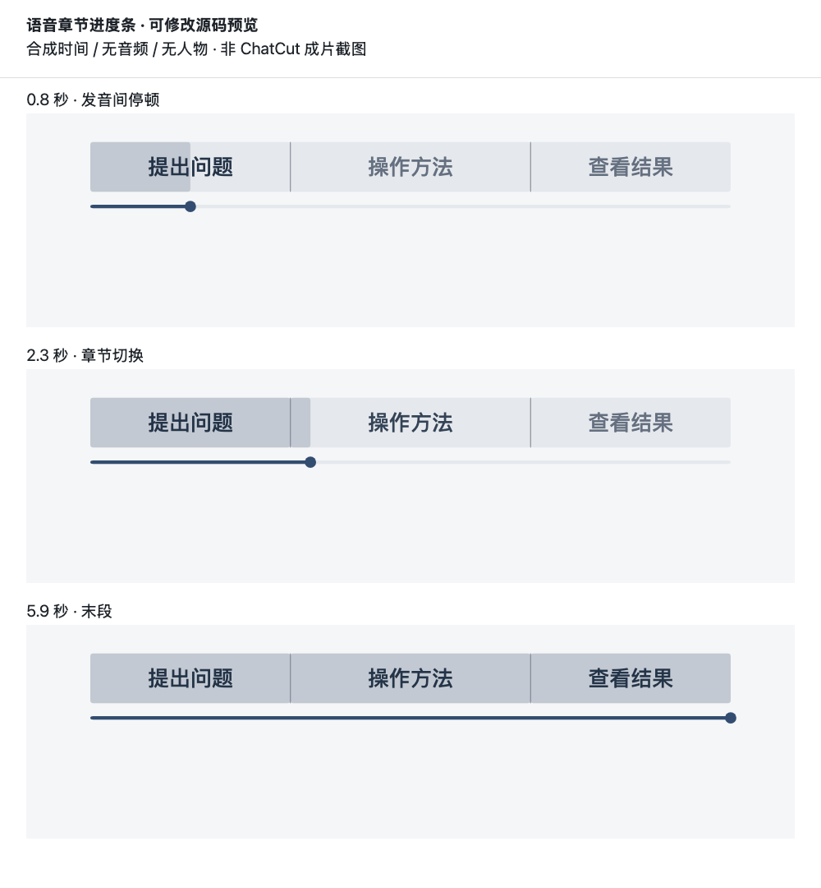

# Bela Skills

李贝拉Bela 的 Agent Skill 合集。用来找选题、写口播、剪视频、做视觉、拆解参考视频，也收录读书、沟通、比价和项目发布工具。

[](https://skills.sh/belalee-ai/bela-skills)

## 推荐安装方式

用 [skills CLI](https://www.skills.sh/docs/cli) 安装，命令会打开 Skill 和 Agent 的选择界面。

```bash
npx skills add belalee-ai/bela-skills
```

只装口播稿到 Codex 项目：

```bash
npx skills add belalee-ai/bela-skills --skill bela-spoken-script -a codex
```

Claude Code 把 `-a codex` 换成 `-a claude-code`；需要全局安装时加 `-g`。要先查看所有条目可加 `--list`。安装后在对应 Agent 里说「用 bela-spoken-script，把这段体验整理成 45 秒能直接录的口播」。

## 按任务找 Skill

### 视频制作

| Skill | 用途 |
| --- | --- |
| [个人剪辑 · `bela-video-editing`](bela-video-editing/SKILL.md) | 从现有口播、录屏或剪辑工程接续，交付粗剪、字幕、动效或验收。 |
| [B-roll 配画 · `bela-broll`](bela-broll/SKILL.md) | 按口播节点设计补充画面，确定风格、人物连续性和实现路线。 |

### 选题与口播

| Skill | 用途 |
| --- | --- |
| [口播稿 · `bela-spoken-script`](bela-spoken-script/SKILL.md) | 把选题或参考稿改成可以直接录的口播。 |
| [AI 新闻视频 · `bela-ai-news-video`](bela-ai-news-video/SKILL.md) | 核实热点事实，整理口播、真实素材和分镜。 |
| [小红书选题 · `bela-topic-picker`](bela-topic-picker/SKILL.md) | 根据账号方向和真实使用证据排序可拍选题。 |
| [内容规划 · `bela-content-planner`](bela-content-planner/SKILL.md) | 根据创作方向和发布节奏整理阶段计划。 |
| [视频选题草案 · `bela-video-topics`](bela-video-topics/SKILL.md) | 把用户主题展开为不同角度的视频选题。 |

### 动效与视觉

| Skill | 用途 |
| --- | --- |
| [App 图标提取 · `bela-app-icon-picker`](bela-app-icon-picker/SKILL.md) | 提取并整理应用图标，输出透明 PNG。 |
| [文字动效库 · `bela-text-motion-library`](bela-text-motion-library/SKILL.md) | 挑选并复用标题、关键词和片头动效，附实现代码。 |
| [章节进度条 · `bela-jindutiao`](bela-jindutiao/SKILL.md) | 为口播或教程设计章节导航，附可运行的进度逻辑和预览。 |
| [动效导演 · `bela-motion-director`](bela-motion-director/SKILL.md) | 先为短视频或网页选动效机制，再做一段可验证的样片。 |
| [贝拉小人物 IP · `bela-ip-pic`](bela-ip-pic/SKILL.md) | 用贝拉原创小人物或自己的角色参考做一致的手绘视觉。 |
| [小红书封面 · `bela-ai-xhs-cover-director`](bela-ai-xhs-cover-director/SKILL.md) | 根据内容类型和证据设计封面，保留小尺寸阅读焦点。 |
| [手绘漫画 · `bela-hand-comic`](bela-hand-comic/SKILL.md) | 把概念、故事和关系画成好懂的手绘漫画。 |
| [视频帧艺术化 · `bela-videoframe-art`](bela-videoframe-art/SKILL.md) | 从指定视频抽帧，选定参考帧和风格后生成艺术图。 |

### 拆解与归档

| Skill | 用途 |
| --- | --- |
| [视频号拆解归档 · `bela-wechat-video-download-copy-to-lark`](bela-wechat-video-download-copy-to-lark/SKILL.md) | 按时间轴拆视频号链接，按用户配置归档到飞书。 |
| [视频号口播复刻 · `bela-channels-remake`](bela-channels-remake/SKILL.md) | 沿用参考视频的结构和节奏，重写自己的口播和镜头表。 |
| [小红书笔记拆解 · `bela-xhs-analysis`](bela-xhs-analysis/SKILL.md) | 读取并分析单篇小红书笔记，提炼内容结构。 |

### 阅读与沟通

| Skill | 用途 |
| --- | --- |
| [高情商回复 · `bela-tactful-replies`](bela-tactful-replies/SKILL.md) | 按关系、目的和场合提供可直接说出口的回复。 |
| [一页读书 · `bela-one-page-book`](bela-one-page-book/SKILL.md) | 根据原书生成梗概、脑图和可回溯到出处的阅读路线。 |

### 开发与发布

| Skill | 用途 |
| --- | --- |
| [GitHub 发布 · `bela-github-publish`](bela-github-publish/SKILL.md) | 为 Skill、应用或工具准备 README、真实截图和安装说明。 |
| [Skill 体检 · `bela-skill-hygiene`](bela-skill-hygiene/SKILL.md) | 检查重复、膨胀和路由冲突，给出清理方案。 |

### 信息简报

| Skill | 用途 |
| --- | --- |
| [职位日报 · `bela-daily-job-briefing`](bela-daily-job-briefing/SKILL.md) | 根据岗位、城市和行业整理有来源的职位更新。 |
| [AI 日报 · `bela-daily-briefing`](bela-daily-briefing/SKILL.md) | 跟进 AI 新闻并整理成带来源的简报。 |

### 日常实用工具

| Skill | 用途 |
| --- | --- |
| [购物车比价 · `bela-cart-savings-advisor`](bela-cart-savings-advisor/SKILL.md) | 从购物车截图整理优惠、拆单与预计到手价。 |

## 怎么搭配用

- 做一期小红书 AI 教程，从选题和口播开始，录完交给个人剪辑。标题、角色和章节导航按需要选用。
- 手上有视频号参考链接，先做时间轴拆解和归档，再决定是否复刻结构。写飞书前配置你自己的目标位置。
- 只需要一个效果，可以单独安装对应 Skill。视频剪辑、图片生成、飞书和网页渲染依赖各 Skill 指定的工具和授权。

## 已发布版本迁移

旧仓库和版本入口见 [迁移清单](MIGRATION.md)。重叠能力合并到一个规范名称。公开版以用户提供的参考、项目文件和配置为输入。

新增 Skill 时，目录名与 `SKILL.md` 文件头的 `name` 都使用 `bela-` 前缀，并同步更新首页分类与目录清单。

[机器可读目录](skills.json) · [在 skills.sh 搜索 bela-skills](https://www.skills.sh/search?q=bela-skills)

## 示例

下面是章节导航的静态预览。最终进度仍按实际口播校时。



[手绘漫画图库与示例](bela-hand-comic/docs/diagram-demos.md) · [手绘漫画功能与维护](bela-hand-comic/docs/maintenance.md)
