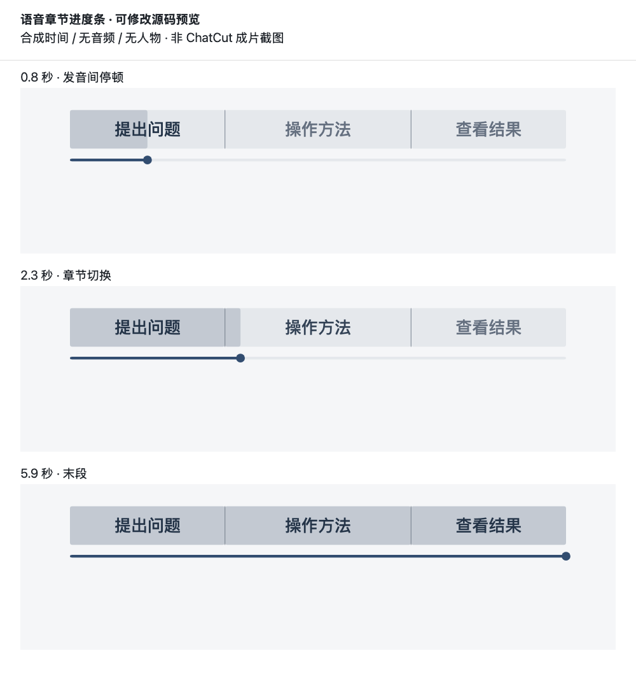

# Bela Skills

李贝拉 Bela 的 Agent Skill 精选集。25 个 Skill，覆盖选题、口播、视频制作、视觉设计、内容拆解，也收录阅读、沟通和日常工具。

[](https://skills.sh/belalee-ai/bela-skills)

[在 skills.sh 浏览合集](https://skills.sh/belalee-ai/bela-skills) · [按任务找 Skill](#按任务找-skill) · [使用前与配套依赖](#使用前与配套依赖)

## 快速安装

先准备 Node.js 与 npm。当前 skills CLI 1.8.1 要求 Node.js ≥ 22.20.0，推荐使用满足要求的 Node.js LTS；后续要求以 [CLI 项目](https://github.com/vercel-labs/skills) 为准。

### 勾选并批量安装

在目标项目目录打开终端，复制运行：

```bash
npx skills add belalee-ai/bela-skills
```

在普通交互终端中，命令会显示 Skill 列表。按提示用空格勾选、回车确认，再选择 Agent、项目级或全局安装等选项。可以只选一个，也可以一次选多个。

若让 Agent 代为执行，CLI 可能自动进入非交互模式；此时用 `--skill` 明确指定要安装的条目。需要自己勾选时，请在系统终端手动运行。

在 skills.sh 合集页复制的是同一条合集命令，勾选在终端完成。安装目标支持 Codex、Claude Code 等 Agent；实际运行能力取决于各 Skill 所需的工具与配置。

### 单独安装

例如，只选口播稿：

```bash
npx skills add belalee-ai/bela-skills --skill bela-spoken-script
```

下面每个分类都附有可展开、单独复制的安装命令。`--skill` 后填写 Skill 的英文名称。

<details>
<summary>更多安装方式：指定多个、全部选中、指定 Agent、全局安装</summary>

一次指定多个 Skill：

```bash
npx skills add belalee-ai/bela-skills --skill bela-spoken-script --skill bela-video-editing
```

选中全部 Skill，再选择安装目标：

```bash
npx skills add belalee-ai/bela-skills --skill '*'
```

指定安装到当前项目的 Codex：

```bash
npx skills add belalee-ai/bela-skills --skill bela-spoken-script -a codex
```

全局安装到 Claude Code：

```bash
npx skills add belalee-ai/bela-skills --skill bela-spoken-script -a claude-code -g
```

只查看可安装条目：

```bash
npx skills add belalee-ai/bela-skills --list
```

`-y` 会跳过交互提示；`--all` 会选中所有 Skill 和所有 Agent 并跳过提示。需要自己勾选时，使用上面的基础命令即可。完整参数见 [skills CLI 文档](https://github.com/vercel-labs/skills/blob/main/docs/commands.md)。

</details>

安装后，在对应 Agent 中提出具体任务，例如：「用 bela-spoken-script，把这段体验整理成 45 秒能直接录的口播。」

## 按任务找 Skill

点击名称查看完整说明；展开分类末尾的安装命令，可复制其中任意一个。


### 视频制作

接续剪辑工程，规划口播与 B-roll 配画。

| Skill | 用途 |
| --- | --- |
| [个人剪辑 · `bela-video-editing`](skills/bela-video-editing/SKILL.md) | 从现有口播、录屏或剪辑工程接续，交付粗剪、字幕、动效或验收。 |
| [视频号口播剪辑 · `bela-channels-recut`](skills/bela-channels-recut/SKILL.md) | 把录好的竖屏口播剪成带实拍素材、双语字幕和动效的视频。 |
| [B-roll 配画 · `bela-broll`](skills/bela-broll/SKILL.md) | 按口播节点设计补充画面，含五种风格参考、人物连续性和分阶段验收。 |

<details>
<summary>视频制作：单项安装命令</summary>

个人剪辑

```bash
npx skills add belalee-ai/bela-skills --skill bela-video-editing
```

视频号口播剪辑

```bash
npx skills add belalee-ai/bela-skills --skill bela-channels-recut
```

B-roll 配画

```bash
npx skills add belalee-ai/bela-skills --skill bela-broll
```

</details>


### 选题与口播

从内容方向和真实证据出发，整理选题、计划与口播。

| Skill | 用途 |
| --- | --- |
| [口播稿 · `bela-spoken-script`](skills/bela-spoken-script/SKILL.md) | 把选题或参考稿改成可以直接录的口播。 |
| [AI 新闻视频 · `bela-ai-news-video`](skills/bela-ai-news-video/SKILL.md) | 核实热点事实，整理口播、真实素材和分镜。 |
| [小红书选题 · `bela-topic-picker`](skills/bela-topic-picker/SKILL.md) | 根据账号方向和真实使用证据排序可拍选题。 |

<details>
<summary>选题与口播：单项安装命令</summary>

口播稿

```bash
npx skills add belalee-ai/bela-skills --skill bela-spoken-script
```

AI 新闻视频

```bash
npx skills add belalee-ai/bela-skills --skill bela-ai-news-video
```

小红书选题

```bash
npx skills add belalee-ai/bela-skills --skill bela-topic-picker
```

</details>


### 动效与视觉

制作封面、漫画、角色视觉、章节导航与文字动效。

| Skill | 用途 |
| --- | --- |
| [文字动效库 · `bela-text-motion-library`](skills/bela-text-motion-library/SKILL.md) | 挑选并复用标题、关键词和片头动效，附实现代码。 |
| [章节进度条 · `bela-jindutiao`](skills/bela-jindutiao/SKILL.md) | 为口播或教程设计章节导航，附可运行的进度逻辑和预览。 |
| [进度条搭子 · `bela-progress-companion`](skills/bela-progress-companion/SKILL.md) | 为已确认需要贝拉角色的进度条制作角色动作与可编辑叠加素材。 |
| [动效导演 · `bela-motion-director`](skills/bela-motion-director/SKILL.md) | 先为短视频或网页选动效机制，再做一段可验证的样片。 |
| [贝拉小人物 IP · `bela-ip-pic`](skills/bela-ip-pic/SKILL.md) | 围绕贝拉小人物及随包参考，制作保持角色一致性的手绘视觉（作者 IP 专用）。 |
| [小红书封面 · `bela-ai-xhs-cover-director`](skills/bela-ai-xhs-cover-director/SKILL.md) | 根据内容类型和证据设计封面，保留小尺寸阅读焦点。 |
| [视频号封面 · `bela-wechat-cover`](skills/bela-wechat-cover/SKILL.md) | 为视频号拟标题，确认后生成并检查 3:4 真人封面。 |
| [手绘漫画 · `bela-hand-comic`](skills/bela-hand-comic/SKILL.md) | 把概念、故事和关系画成好懂的手绘漫画。 |
| [视频帧艺术化 · `bela-videoframe-art`](skills/bela-videoframe-art/SKILL.md) | 从指定视频抽帧，选定参考帧和风格后生成艺术图。 |
| [App 图标提取 · `bela-app-icon-picker`](skills/bela-app-icon-picker/SKILL.md) | 提取并整理应用图标，输出可用的透明 PNG。 |
| [手写字转字体 · `bela-draw-your-font`](skills/bela-draw-your-font/SKILL.md) | 从手写字照片生成可安装的 TTF 字体，也可导出 WOFF、WOFF2 和 CSS。 |

<details>
<summary>动效与视觉：单项安装命令</summary>

文字动效库

```bash
npx skills add belalee-ai/bela-skills --skill bela-text-motion-library
```

章节进度条

```bash
npx skills add belalee-ai/bela-skills --skill bela-jindutiao
```

进度条搭子

```bash
npx skills add belalee-ai/bela-skills --skill bela-progress-companion
```

动效导演

```bash
npx skills add belalee-ai/bela-skills --skill bela-motion-director
```

贝拉小人物 IP

```bash
npx skills add belalee-ai/bela-skills --skill bela-ip-pic
```

小红书封面

```bash
npx skills add belalee-ai/bela-skills --skill bela-ai-xhs-cover-director
```

视频号封面

```bash
npx skills add belalee-ai/bela-skills --skill bela-wechat-cover
```

手绘漫画

```bash
npx skills add belalee-ai/bela-skills --skill bela-hand-comic
```

视频帧艺术化

```bash
npx skills add belalee-ai/bela-skills --skill bela-videoframe-art
```

App 图标提取

```bash
npx skills add belalee-ai/bela-skills --skill bela-app-icon-picker
```

手写字转字体

```bash
npx skills add belalee-ai/bela-skills --skill bela-draw-your-font
```

</details>


### 拆解与归档

分析参考内容，整理复刻思路与可追溯的归档。

| Skill | 用途 |
| --- | --- |
| [视频号拆解归档 · `bela-wechat-video-download-copy-to-lark`](skills/bela-wechat-video-download-copy-to-lark/SKILL.md) | 按时间轴拆视频号链接，按用户配置归档到飞书。 |
| [视频号口播复刻 · `bela-channels-remake`](skills/bela-channels-remake/SKILL.md) | 沿用参考视频的结构和节奏，重写口播和镜头表（作者工作流）。 |
| [小红书笔记拆解 · `bela-xhs-analysis`](skills/bela-xhs-analysis/SKILL.md) | 读取并分析单篇小红书笔记，提炼内容结构。 |

<details>
<summary>拆解与归档：单项安装命令</summary>

视频号拆解归档

```bash
npx skills add belalee-ai/bela-skills --skill bela-wechat-video-download-copy-to-lark
```

视频号口播复刻

```bash
npx skills add belalee-ai/bela-skills --skill bela-channels-remake
```

小红书笔记拆解

```bash
npx skills add belalee-ai/bela-skills --skill bela-xhs-analysis
```

</details>


### 阅读与沟通

整理阅读线索，按具体关系和场合组织表达。

| Skill | 用途 |
| --- | --- |
| [高情商回复 · `bela-tactful-replies`](skills/bela-tactful-replies/SKILL.md) | 按关系、目的和场合提供可直接说出口的回复。 |
| [一页读书 · `bela-one-page-book`](skills/bela-one-page-book/SKILL.md) | 根据原书生成梗概、脑图和可回溯到出处的阅读路线。 |

<details>
<summary>阅读与沟通：单项安装命令</summary>

高情商回复

```bash
npx skills add belalee-ai/bela-skills --skill bela-tactful-replies
```

一页读书

```bash
npx skills add belalee-ai/bela-skills --skill bela-one-page-book
```

</details>


### 开发与发布

整理项目展示，检查 Skill 的结构和重复能力。

| Skill | 用途 |
| --- | --- |
| [GitHub 发布 · `bela-github-publish`](skills/bela-github-publish/SKILL.md) | 为 Skill、应用或工具准备 README、真实截图和安装说明。 |

<details>
<summary>开发与发布：单项安装命令</summary>

GitHub 发布

```bash
npx skills add belalee-ai/bela-skills --skill bela-github-publish
```

</details>


### 信息简报

[查看职位日报与 AI 日报的历史版本](MIGRATION.md#历史版本)


### 日常实用工具

处理购物比价和本地图片压缩等日常任务。

| Skill | 用途 |
| --- | --- |
| [购物车比价 · `bela-cart-savings-advisor`](skills/bela-cart-savings-advisor/SKILL.md) | 从购物车截图整理优惠、拆单与预计到手价。 |
| [图片压缩 · `bela-tiny-png`](skills/bela-tiny-png/SKILL.md) | 用 TinyPNG API 批量压缩、缩放及转换图片格式。 |

<details>
<summary>日常实用工具：单项安装命令</summary>

购物车比价

```bash
npx skills add belalee-ai/bela-skills --skill bela-cart-savings-advisor
```

图片压缩

```bash
npx skills add belalee-ai/bela-skills --skill bela-tiny-png
```

</details>


## 使用前与配套依赖

安装 Skill 会提供它的说明、脚本和随包资源，外部软件、账号、API key 与其他 Skill 需要按对应说明准备。每个 Skill 都可以单独选择安装，但部分流程需要配套能力。

| Skill / 场景 | 使用前确认 |
| --- | --- |
| `bela-broll`、`bela-ai-news-video`、`bela-text-motion-library` | 正文引用 `bela-video-editing` 的流程或参考文件，使用相应流程时一并安装。 |
| `bela-video-editing` | 根据任务使用 ChatCut 等工具；需要章节进度条时，另装 `bela-jindutiao`。其他配套项见其工具清单。 |
| `bela-spoken-script` | 可单独写稿；继续制作视频时再配合 `bela-video-editing`。 |
| `bela-channels-remake` | 沿用作者的策划方式；录制后接剪辑时可一并安装 `bela-channels-recut`。 |
| `bela-channels-recut` | 需自备原片和素材。Hypit 优先，或使用随包 Remotion 模板；分别配置依赖。 |
| `bela-progress-companion` | 先配合 `bela-jindutiao` 判断是否需要角色。随包提供角色素材、分层模板和动作参考。 |
| `bela-wechat-cover` | 标题与版式可先准备；生成成品需图片生成工具和当次真人照片。DBS 标题库可选。 |
| `bela-ip-pic` | 围绕作者的 Bela 角色与参考资产工作，不是通用的人物替换工具。 |
| `bela-wechat-video-download-copy-to-lark` | 依赖视频号下载、Hypit、飞书 CLI、FFmpeg、转录等工具与配套 Skill；先配置自己的账号、权限和归档位置，并通过其依赖检查。 |
| `bela-xhs-analysis` | 依赖可用的内容读取工具或 Python 路径；需要登录态时使用自己的账号配置。 |
| `bela-tiny-png` | 需要 TinyPNG API key 与 Python 依赖；运行时会上传待处理图片，留意服务配额。 |
| `bela-draw-your-font` | 需要 Node.js ≥ 18，首次运行可能需要通过 npm 安装 CLI，字体在本地生成。改编自 [Danilo Znamerovszkij 的 draw-your-font](https://github.com/danilo-znamerovszkij/draw-your-font)，保留 MIT 许可。 |
| 漫画、封面、IP、视频帧艺术化等视觉任务 | 需要对应的图片生成或编辑能力；安装 Skill 本身不会提供生成服务。 |

例如，安装 B-roll 配画及其配套流程：

```bash
npx skills add belalee-ai/bela-skills --skill bela-broll --skill bela-video-editing
```

本次整理保留现有 Skill 的功能与资源，上述个人化内容和旧依赖尚未通用化。详细说明以各自 `SKILL.md` 为准。

## 怎么搭配用

- 做一期 AI 教程：先选题、写口播，录完交给个人剪辑，按需要加入 B-roll、文字动效和章节导航。
- 研究参考内容：先拆解视频号或小红书笔记，保留来源与证据，再决定是否借鉴结构。
- 只完成一件小事：按需安装读书、回复、比价或图片压缩 Skill，并准备它所需的工具。

## 示例

章节导航静态预览；实际进度需按录制后的口播校时。



[手绘漫画图库与示例](skills/bela-hand-comic/docs/diagram-demos.md) · [手绘漫画功能与维护](skills/bela-hand-comic/docs/maintenance.md)

## 项目结构与维护

```text
bela-skills/
├── skills/
│   └── bela-<name>/
│       ├── SKILL.md
│       └── ...              # 该 Skill 自己的脚本、参考资料和资源
├── README.md                # 用途、安装与技能索引
├── skills.json              # 机器可读目录
├── skills.sh.json           # skills.sh 合集页分组
├── AGENTS.md                # 通用维护规范
├── CLAUDE.md                # Claude Code 入口，引用共同规范
├── MEMORY.md                # 已确认的项目决策与已知遗留
└── MIGRATION.md             # 旧仓库与目录迁移说明
```

新增 Skill 时，目录名与 `SKILL.md` 的 `name` 使用相同的 `bela-` 名称，并同步 README、`skills.json` 和 `skills.sh.json`。分类用于导航，Skill 目录保持一层，方便单独分发。

`npx skills` 直接读取这些 Skill，无需发布 npm 包。`skills.json` 是本项目的目录索引，不是安装器配置。技能内的许可与第三方声明随原文件保留。

skills.sh 的合集页和单项页提供安装命令复制入口。网站通过启用遥测的 CLI 安装记录收录 Skill，并读取默认分支上的分组配置；收录与缓存刷新可能延迟，推送代码不等于网站立即更新。参见 [收录说明](https://www.skills.sh/docs/faq) 与 [分组说明](https://www.skills.sh/docs/customize)。

[维护规范](AGENTS.md) · [项目决策](MEMORY.md) · [迁移清单](MIGRATION.md) · [机器可读目录](skills.json)
